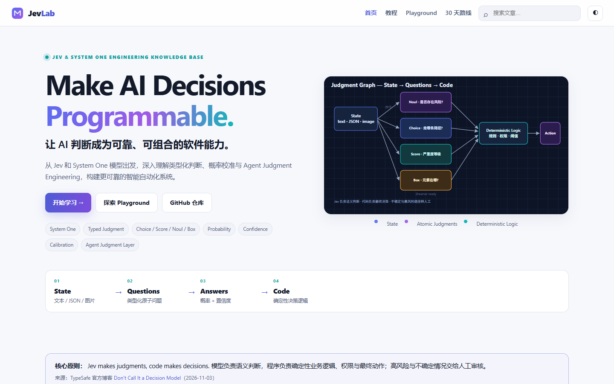
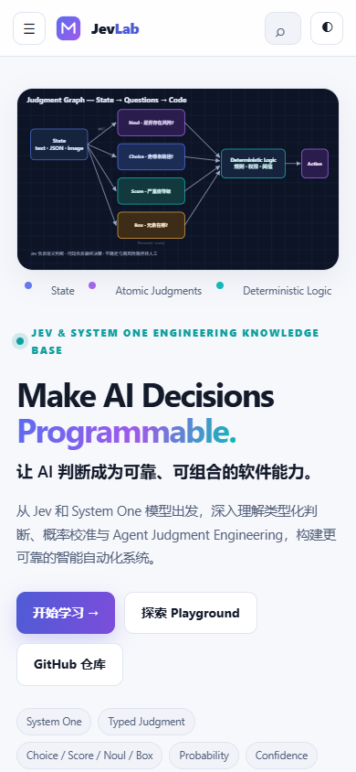
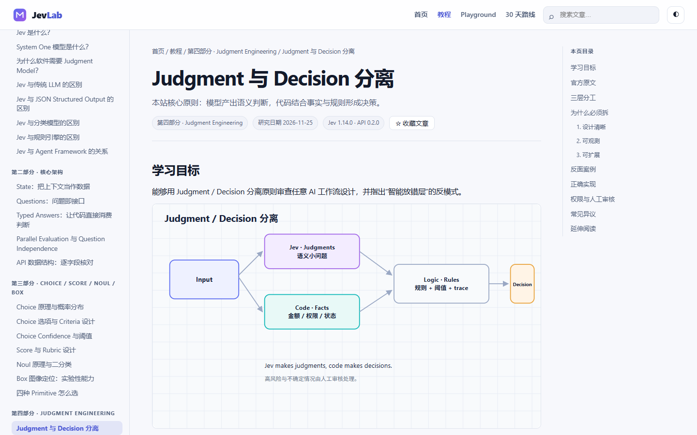
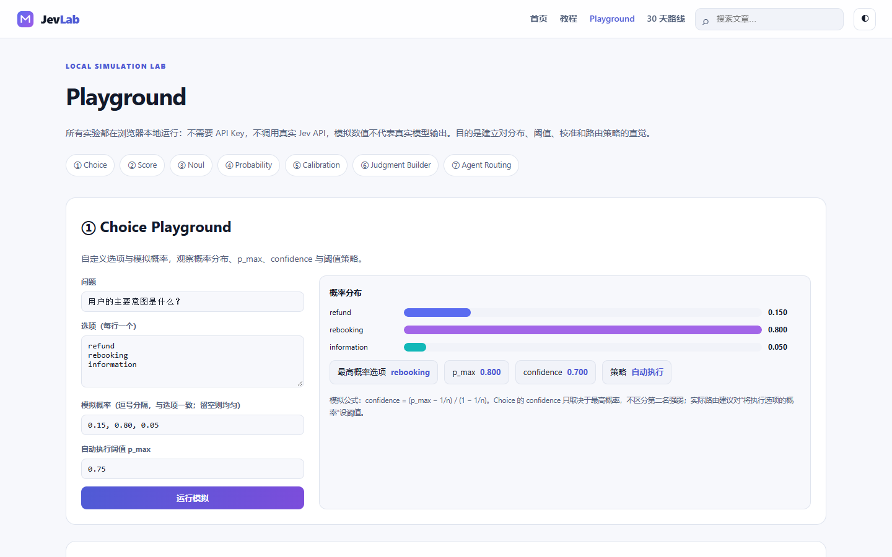
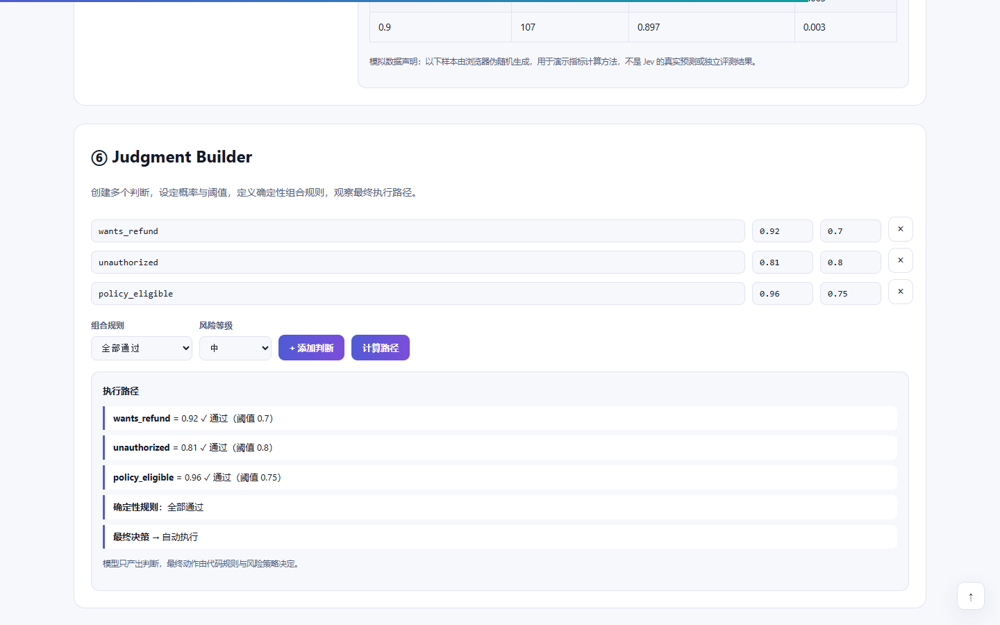
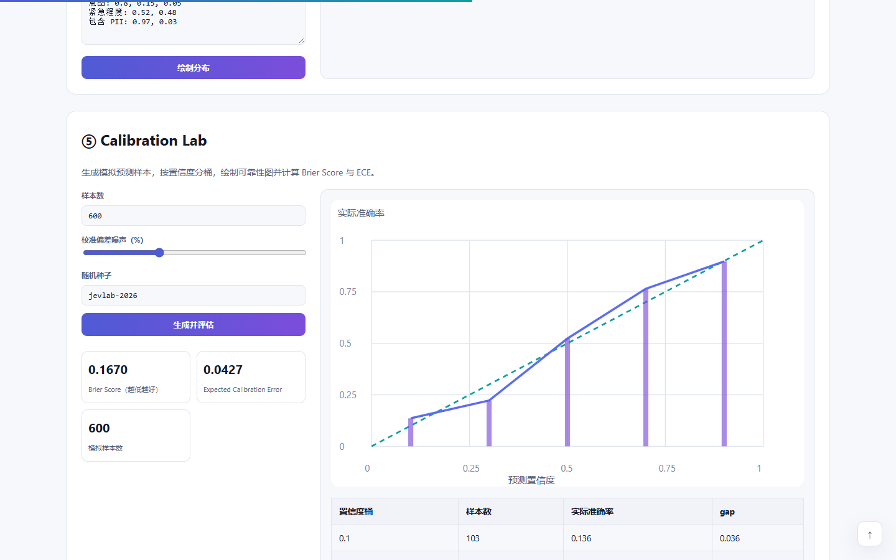
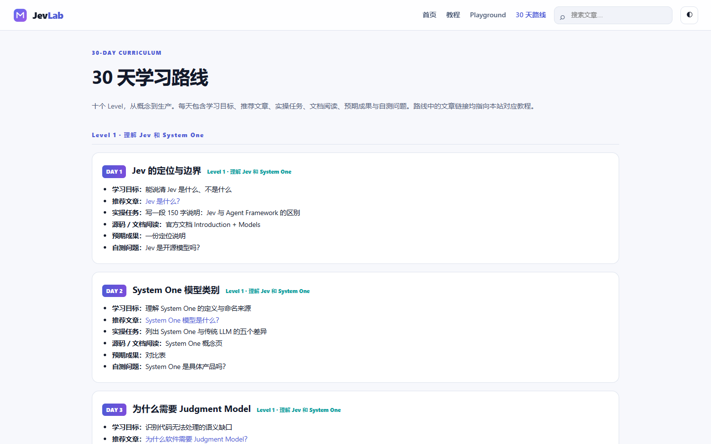

# JevLab

**Jev & System One Engineering Knowledge Base** · Jev 深度研究与 Agent 判断工程实践。

JevLab 是一个从零构建的中文技术教程网站，系统研究 Jev、System One Models、Typed Judgment、Probability、Confidence 与 Calibration，并把这些能力落到可靠的 Agent Judgment Engineering 与 Judgment Runtime 实践中。

> **核心原则：Jev makes judgments, code makes decisions.**
> 模型负责语义判断，代码负责确定性业务逻辑、权限与最终动作；高风险与不确定情况交给人工审核。
> 来源：[TypeSafe 官方博客 · Don't Call It a Decision Model](https://typesafe.ai/blog/dont-call-it-a-decision-model)（2026-11-03）。

---

## 在线网站

- GitHub 仓库：<https://github.com/yuxinrun/jevlab>
- GitHub Pages：<https://yuxinrun.github.io/jevlab/>
- 自定义域名（实际访问地址）：<https://www.yuxin.run/jevlab/>

> 由于账号主站 `yuxinrun.github.io` 已绑定自定义域名 `www.yuxin.run`，GitHub 会把 `yuxinrun.github.io/jevlab/` 自动重定向到 `https://www.yuxin.run/jevlab/`。这是 GitHub Pages 的域名继承行为，不是站点故障；请以后者作为正式地址。

本站是独立技术教程项目，不是 TypeSafe 官方网站。

---

## 研究基线与准确性声明

| 项目 | 值 | 研究日期 |
| --- | --- | --- |
| 模型 | `jev-1.14.0`（`jev-latest` 当前指向此版本） | 2026-11-25 |
| System One API | `0.2.0` | 2026-11-25 |
| OpenAPI | `3.1.0` | 2026-11-25 |
| Python SDK | `typesafe-sdk`（模块 `typesafe_sdk`） | 2026-11-25 |
| JavaScript SDK | `@typesafe-ai/sdk`（文档关联 v0.7.0） | 2026-11-25 |

准确性规则：

- 所有 API 字段均以 `https://api.typesafe.ai/openapi.json` 原文核对。
- `NoulAnswer` **没有** `confidence` 字段；`probabilities` 只出现在 Choice / Score。
- `BoxAnswer.confidence` 在 schema 中允许 `null`；Box 与 Images 需要 `TypeSafe-Danger-Zone-Images: true`，官方标记为 Dreamer-ready，非生产稳定能力。
- Jev 是闭源托管服务；本站不描述未公开的网络结构、参数、训练数据或采样实现。
- 厂商发布的速度、成本与评测数字一律标注为“厂商声明”，不作为独立验证结论。
- 官方概念页明确：校准是群体层面的性质，不保证单个答案正确。

研究记录见 `public/content/research-notes.json`（构建时生成）。

---

## 网页截图

以下截图均通过真实浏览器运行网站后使用 Playwright CLI 截取，不是设计稿。

### 首页（桌面）



### 首页（手机）



### 文章页



### Choice Playground



### Judgment Builder



### Calibration Lab



### 学习路线



---

## 技术栈

- Vite 5 + TypeScript（类型检查）
- 原生 HTML / CSS / JavaScript，无 UI 组件库、无动画库、无图表库
- 轻量自研 Markdown 渲染器（`src/utils/markdown.mjs`），浏览器与构建脚本共用
- 原生 SVG 本地绘图，25 张架构图
- 静态预渲染：33 篇文章在构建时生成真实 HTML 页面，刷新不依赖 SPA fallback
- 浏览器本地搜索索引，无后端
- GitHub Actions + 官方 Pages Actions 部署

---

## 内容目录

1. **Jev 入门**（8 篇）：定位、System One、Judgment Model、与 LLM / JSON 输出 / 分类器 / 规则引擎 / Agent Framework 的区别。
2. **核心架构**（5 篇）：State、Questions、Typed Answers、Parallel Evaluation、API 数据结构。
3. **Choice / Score / Noul / Box**（7 篇）：原理、设计、confidence、rubric、实验性图像能力、类型选择。
4. **Judgment Engineering**（3 篇）：Judgment / Decision 分离、Atomic Questions、Deterministic Logic。
5. **Probability / Confidence**（3 篇）：概率与置信度、Calibration、风险自动化与人在回路。
6. **API 与 SDK**（2 篇）：Quickstart、错误处理与重试。
7. **Agent 集成**（2 篇）：Judgment Layer、Tool / Model / Skill Routing。
8. **生产工程化**（1 篇）：Evaluation Pipeline。
9. **实战**（2 篇）：客服工单路由、自研 Judgment Runtime。

共 **33 篇**有实质内容的中文文章。每篇包含学习目标、背景、核心概念、架构图、数据结构、代码示例、运行方法、错误处理、常见问题、设计取舍与延伸阅读。示例使用当前公开 API / SDK，不虚构字段与能力；模拟数据在文中明确标注为模拟。

### 站点页面

- 独立首页：Hero、Judgment Graph、对比、四种原语、原子判断、概率、Agent Layer、Playground 入口、实战、路线、官方资源。
- Playground：Choice、Score、Noul、Probability Explorer、Calibration Lab、Judgment Builder、Agent Routing Lab，共 7 个浏览器本地实验。
- 30 天学习路线：10 个 Level，每天含目标、文章、实操、文档阅读、成果与自测题。

---

## 本地运行

要求 Node.js 18+（推荐 22）。

```bash
npm install
npm run dev
```

开发服务器地址：<http://127.0.0.1:5173/jevlab/>

`npm run dev` 会先生成文章 Markdown、搜索索引与 SVG，再启动 Vite。所有内容源在 `content/`，生成副本在 `public/`。

---

## 构建方法

```bash
npm run typecheck   # TypeScript 检查
npm run build       # 生成内容 + Vite 多页面构建 + 预渲染 + sitemap
npm run preview     # 本地预览 dist，地址 /jevlab/
npm run verify      # 校验内部链接、SVG、sitemap 与资源
```

构建输出在 `dist/`，包含：

- 1 个首页、33 个文章静态页、Playground、学习路线、404
- `sitemap.xml`、`robots.txt`、`favicon.svg`
- 25 张本地 SVG 架构图
- 本地搜索索引与文章 Markdown 副本

截图可用真实浏览器重新生成：

```bash
npm run preview
npm run capture
```

`npm run capture` 依赖已安装的 `playwright-cli`，需要先启动预览服务。

---

## GitHub Pages 部署

1. **必须先启用 Pages**：在仓库页面进入 **Settings → Pages**，Build and deployment 的 Source 选择 **GitHub Actions** 并保存。若未做这一步，`actions/configure-pages@v5` 会报 `Get Pages site failed ... Not Found` 并导致部署失败。
2. 仓库根目录已有 `.github/workflows/deploy.yml`，推送到 `main` 后自动执行：
   - `actions/checkout@v4`
   - `actions/setup-node@v4`（Node 22）
   - `npm install`
   - `npm run typecheck`
   - `actions/configure-pages@v5`
   - `npm run build`
   - `actions/upload-pages-artifact@v3`（上传 `dist`）
   - `actions/deploy-pages@v4`
3. 部署完成后访问 <https://www.yuxin.run/jevlab/>（或访问 `yuxinrun.github.io/jevlab/`，会自动重定向到该地址）。

子路径适配：

- Vite `base` 固定为 `/jevlab/`。
- 所有内部链接、图片、脚本、样式均使用 `/jevlab/` 前缀。
- 文章是真实静态目录页，刷新不会出现 404。
- 404 页由 GitHub Pages 自动服务。
- favicon、sitemap、robots 均位于站点根路径。

---

## 目录结构

```text
jevlab/
├── public/
│   ├── diagrams/          # 25 张本地 SVG（构建生成）
│   ├── content/           # 运行时 Markdown / manifest / 搜索索引（构建生成）
│   ├── favicon.svg
│   ├── robots.txt
│   └── sitemap.xml        # 预渲染生成
├── src/
│   ├── assets/
│   ├── components/
│   ├── layouts/
│   ├── pages/
│   ├── styles/main.css
│   ├── data/
│   ├── utils/markdown.mjs
│   ├── lab/labs.mjs
│   └── main.ts
├── content/               # 文章 Markdown 源（按分类）
│   ├── introduction/  architecture/  primitives/  judgment/
│   ├── probability/   api/           integration/ production/  practice/
├── scripts/
│   ├── content/           # 文章数据源
│   ├── data/learning-path.mjs
│   ├── generate-content.mjs
│   ├── generate-diagrams.mjs
│   ├── prerender.mjs
│   ├── verify.mjs
│   └── capture.mjs
├── screenshots/
├── .github/workflows/deploy.yml
├── index.html             # 独立首页
├── playground/index.html
├── learning-path/index.html
├── 404.html
├── package.json
├── tsconfig.json
├── vite.config.ts
├── README.md
└── LICENSE
```

---

## 图片来源

- 所有架构图、示意图与 Hero 主视觉均为本项目使用原生 SVG 自行绘制，由 `scripts/generate-diagrams.mjs` 生成。
- 图片全部保存在仓库 `public/diagrams/`，无远程图片热链，无外部字体依赖。
- 未下载或使用第三方图片，因此无需第三方授权声明。
- 截图由 Playwright CLI 对本地真实站点截取，保存在 `screenshots/`。

---

## 质量检查报告（2026-11-25，实际执行）

| 检查项 | 结果 |
| --- | --- |
| `npm install` | 通过（12 个初始包 + @types/node） |
| `npm run typecheck` | 通过，0 错误 |
| `npm run build` | 通过，33 篇文章 + 25 张 SVG |
| `npm run verify` | 通过，37 个 HTML、62 个本地引用、0 问题、26 个 SVG 均完整 |
| 全站路由 HTTP 检查 | 首页、文章、Playground、学习路线、sitemap、robots、favicon、SVG 均 200 |
| 官方 API Schema 核对 | OpenAPI 3.1.0 / API 0.2.0，逐字段核对请求、响应、错误与 danger zone 头 |
| PC 布局 | 1440×900 实际截图检查通过 |
| 手机布局 | 390×844 实际截图检查，`scrollWidth === innerWidth`，无横向溢出 |
| 全站搜索 | 实际触发，返回匹配结果 |
| 主题切换 | 实际点击，`data-theme` 在 light/dark 间切换 |
| 代码复制 | 文章页检测到 12 个复制按钮 |
| 自动目录 | 检测到 12 个目录项 |
| Choice Playground | 实际点击运行，输出分布、p_max、confidence 与策略 |
| Judgment Builder | 实际点击运行，输出执行路径 |
| Calibration Lab | 实际点击运行，生成可靠性图、Brier Score、ECE |
| Agent Routing Lab | 实际点击运行，输出路由路径 |
| GitHub Pages base path | Vite base 与全部链接使用 `/jevlab/`，本地预览验证通过 |
| 部署配置 | 使用官方 Pages Actions，`permissions` 与 `concurrency` 已配置 |
| 真实截图 | 7 张，全部由 Playwright CLI 对运行中的站点截取 |

已知限制：

- `npm install` 报告 2 个来自间接依赖的安全告警（1 moderate、1 high）；当前构建与运行不受影响，未使用 `audit fix --force` 避免引入破坏性升级。
- 本地 `vite preview` 对未知路径返回 SPA fallback（200）；GitHub Pages 会对未知路径服务 `404.html`。
- 本站不调用真实 Jev API；Playground 全部是浏览器本地模拟。

---

## 贡献指南

1. Fork 仓库并新建分支。
2. 文章内容修改 `scripts/content/*.mjs` 中的数据源，然后运行 `npm run generate` 生成 `content/` 与 `public/content/`。
3. 新增文章需设置唯一 `slug`、正确 `category`，并在需要时更新学习路线数据。
4. 提交前运行 `npm run typecheck && npm run build && npm run verify`。
5. 保持准确性：不虚构 API 字段、不把模拟数据写成真实调用、不把厂商声明写成独立验证。
6. 提交信息使用 conventional commit，例如 `feat: add guardrail article`。

---

## 官方文档

- TypeSafe：<https://typesafe.ai/>
- 文档索引：https://docs.typesafe.ai/llms.txt
- Introduction：https://docs.typesafe.ai/introduction
- System One：https://docs.typesafe.ai/concepts/system-one
- Primitives：https://docs.typesafe.ai/primitives
- Confidence：https://docs.typesafe.ai/confidence
- Models：https://docs.typesafe.ai/models
- Patterns：https://docs.typesafe.ai/patterns
- Cookbooks：https://docs.typesafe.ai/cookbooks
- System One API：https://docs.typesafe.ai/api/system-one
- Request rules and errors：https://docs.typesafe.ai/api/errors
- OpenAPI：<https://api.typesafe.ai/openapi.json>
- Python SDK：https://docs.typesafe.ai/sdk/python
- JavaScript SDK：https://docs.typesafe.ai/sdk/javascript
- 官方集成指导：<https://github.com/typesafe-ai/skills>
- 官方博客：<https://typesafe.ai/blog/>

---

## License

[MIT](LICENSE) © 2026 yuxinrun
